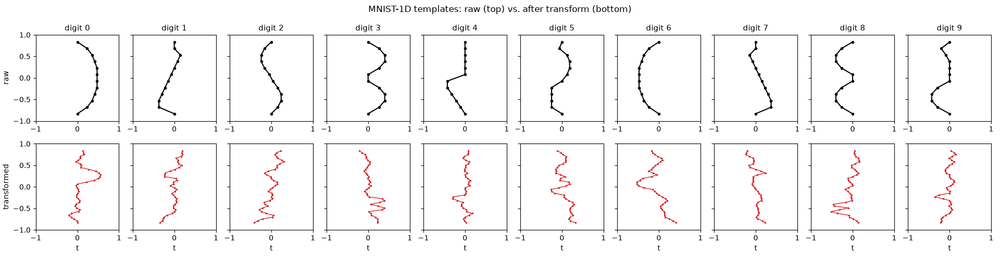
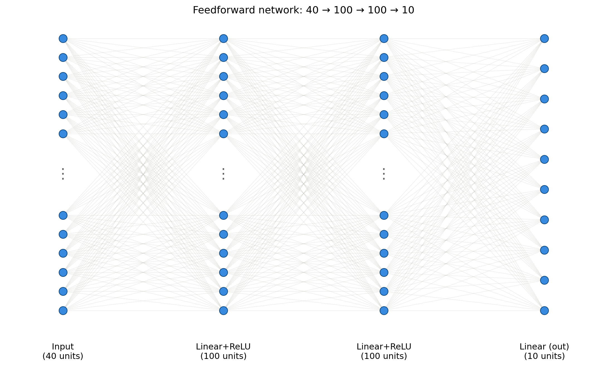
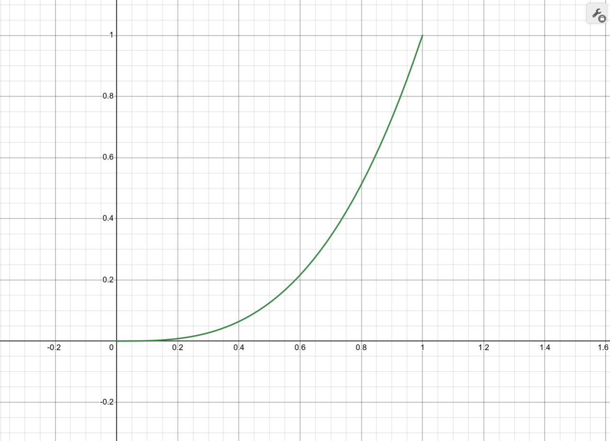
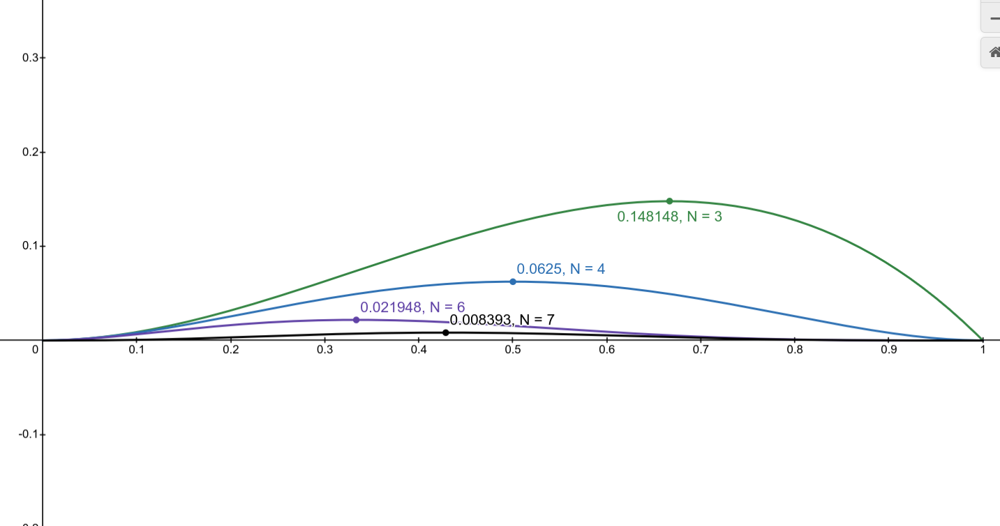
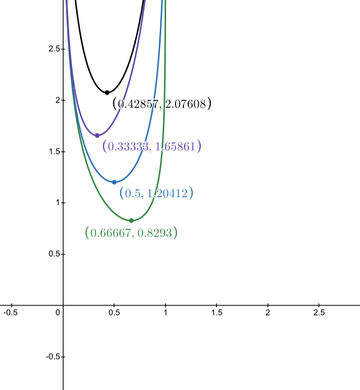
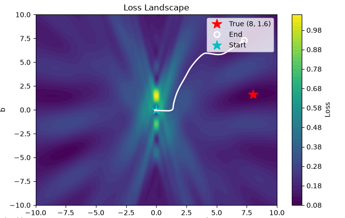
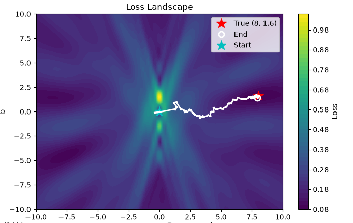
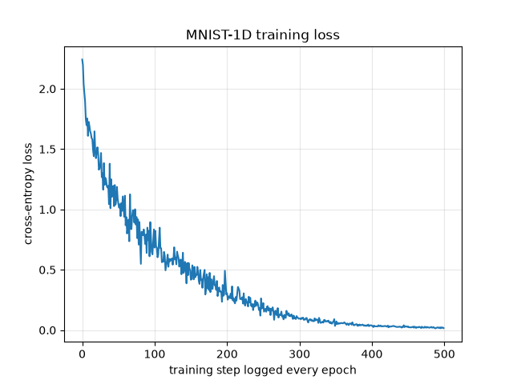

# Introduction

This is a deep dive analysis of how I trained a simple Feed Forward model to classify the MNIST-1D [@greydanus2024scaling] dataset without using pytorch. Just numpy.

## What exactly is the MNIST-1D dataset ?

Of course any person who have done any sort of AI/ML has got to know of the iconic MNIST (Modified National Institute of Standards and Technology) dataset [@mnist], a collection of handwritten images with labels. It is often thought as the "hello world" equivalent of Machine Learning.

What makes the MNIST-1D different however is that instead of classifying 2 dimensional images (with size of 28x28), it classifies a flattened 40 dimensional vector

{width=70%}

Another interesting property of the MNIST-1D dataset is that it helps to differentiate if the model has spatial inductive bias, if it generalizes to new data, and if it is either a linear or non-linear model.

## Simple Model description

Of course, since the MNIST dataset input $x_i$ and the dataset output $y_i$ from the dataset $I = \{x_i, y_i\}_{i=1}^N$ are of size 40 and 10 respectively, we need a _function_ that is capable of taking said inputs and outputs.

Lets define the model as $f[x, \phi]$ where it takes in a vector $x$ with parameters $\phi$.

One way of modeling such a function is through a Neural network or a MLP (Multi Layered Perceptron). Visually it looks as follows:

{width=70%}

The above diagram can be modeled through the following operations:

$$f_0 = W_0 X_0 + B_0$$
$$h_1 = a(f_0)$$
$$f_1 = W_1 h_1 + B_1$$
$$h_2 = a(f_2)$$
$$f_2 = W_2 h_2 + B_2$$

Where $W_0 \in \mathbb{R}^{100 \times 40}, B_0 \in \mathbb{R}^{100}, W_1 \in \mathbb{R}^{100 \times 100}, B_1 \in \mathbb{R}^{100 \times 1}, W_2 \in \mathbb{R}^{10 \times 100}, B_2 \in \mathbb{R}^{10}$ and the function $a(\mathbf{x})$ is a ReLU function.

Of course prior to training the parameters $\phi$ given from a FCN, one must have a "criteria" or conventionally a function that describes how well it fits the dataset $I$. Said criterion is called a _loss_ function.

# But, What exactly is a loss function ?

A loss function, is as stated prior, a reliable indicator of how well the model fits with the dataset. Now of course finding said function is the part that is tricky. For instance, one might naively assume that just summing up the absolute difference i.e : $\sum_{i=1}^N |y_i - f[x_i, \phi]|$ might give, in the case of a regression task, a reliable indicator of how well it fits. However, one might ask why did I use the absolute value and not the squared of their difference ? or instead of it being the squared difference, it is instead the difference with the power of $2k$, where $k \in \{1, 2, \ldots, \infty \}$. Amongst all different possible forms of loss functions, which one is the _best_ ?

Lets shift the perspective entirely and re-word the entire problem. The problem here is that we need to find the accurate parameters $\phi$ for the model $f$ given the dataset $I$. If we treat the samples $I$ as being random variables $X, Y$ sampled from a probability distributions $P \in P_n$ (where $P_n$ is the set containing all different families of probability distributions) and what we need to find is the following distribution:

$$P(Y_1, Y_2, \ldots Y_n \mid X_1, X_2, \ldots X_n)$$

Of course we can further refine this distribution by replacing the random variables $X$ with the _function's_ output given $X$ with the parameters $\phi$, Meaning:

$$P(Y_1, Y_2, \ldots Y_n \mid f[x_1, \phi], f[x_2, \phi], \ldots f[x_n, \phi])$$

is the probability distribution that best describes the samples from the dataset.

However, finding the probability distribution is the tricky party. Since the probability distribution is dependent on the parameter $\phi$. We do this with the _likelihood function_

A likelihood function is a function that basically represents how likely the parameter $\phi$ best represents the probability distribution. Which funnily enough is the exact thing we need and described as a loss function. So, finding the probability distribution's likelihood function is equivalent to finding the _best_ loss function (provided that the probability distribution's family $P_n$ is the correct one we chose).

The likelihood function is, by treating the phi as the input, as follows:

$$L(\phi) = P(Y_1, Y_2, \ldots Y_n \mid f[x_1, \phi], f[x_2, \phi], \ldots f[x_n, \phi])$$

Hence, finding the parameter $\phi$ that maximizes this function is the distribution we seek

$$\hat{\phi} = \operatorname{argmax}_\phi [P(Y_1, Y_2, \ldots Y_n \mid f[x_1, \phi], f[x_2, \phi], \ldots f[x_n, \phi])]$$

if we also operate under the assumption that the dataset is i.i.d (independent and identically distributed [^iid]), then:

[^iid]: isn't it funny how if you change the abbreviation of i.i.d to either identical and independently distributed or independent and identically distributed, they both represent the same thing. So in a sense both abbreviations are i.i.d. Haha ... (I need friends.)

$$\hat{\phi} = \operatorname{argmax}_\phi \left[ \prod_{i=1}^N P(Y_i \mid f[x_i, \phi]) \right]$$

However the theoretical formulation of the likelihood function may seem un-intuitive, so lets start with a simpler explanation

Lets assume that we have samples $Y = \{1, 1, 1\}$ taken from an Bernoulli distribution sampled 3 times. Assume that the trials are i.i.d. So the Likelihood function for the probability distribution $P(1,1,1 \mid p)$:

$$L(p \mid x) = P(1,1,1 \mid p) = p(1 \mid p) p(1 \mid p) p(1 \mid p) = (1-p)^0 p \cdot (1-p)^0 p \cdot (1-p)^0 p = p^3$$

When we plot the likelihood function:

{width=50%}

From here we can infer that by taking $p=1$, we maximize the likelihood function and find the parameters

If we do increase the size of the dataset, then the maximum parameter that is found from the likelihood function is closer to the _true_ parameter that describes the distribution. You can see this being true through the following python code:

```python
import numpy as np
def clamp(value, min_value, max_value):
    return max(min_value, min(value, max_value))
N = int(input("enter sample size, I recommend 67, but doing 67 product operations is not funny, so just pick 10 : "))
# for reference please look at : https://imgflip.com/i/ay4gvb
if N == 67:
    print("How cute")
elif N == 10:
    print("Good Entity")
N = clamp(N, 2, 20)
#
# this is the one we intend to predict
true_p = np.random.uniform(0, 1)
# from this number of samples
sample = np.random.binomial(n=1, p=true_p, size=N)
likelihood_p = max([(1-float(p))**(len(samples) - np.sum(samples)) * float(p)**(np.sum(samples)) for p in np.linspace(0, 1, 0.01)])
print(likelihood_p, true_p)
```

However, if we do increase the size of the dataset, we come across another problem. That being the products of the parameters continually become smaller and smaller.

While the theoretical assumptions of the likelihood function are sound, it becomes computationally infeasible. The reason being, finding the parameter $\hat{\phi}$ becomes harder as the function's range become closer and closer to zero.

{width=90%}

To solve this, all we need to do is to compose this by a function that _preserves_ the position of $l(\hat{\phi})$ while making it easier to compare. Such functions that satisfy said criteria are called _monotonic_ functions.

One example of a monotonic function is the log function. Let $g(x) = \log(x)$ and since $g$ is a monotonic function:

$$\hat{\phi} = \operatorname{argmax}_\phi [l(\phi)] \Rightarrow \hat{\phi} = \operatorname{argmax}_\phi [g(l(\phi))]$$

We can also reformulate the equation to minimize the loss function as opposed to maximizing it by multiplying it with $-1$.
Hence:

$$\hat{\phi} = -\operatorname{argmin}_\phi [\log(l(\phi))]$$
$$\hat{\phi} = -\operatorname{argmin}_\phi \left[ \log\left(\prod_{i=1}^N P(Y_i \mid f[x_i, \phi])\right) \right]$$
$$\hat{\phi} = -\operatorname{argmin}_\phi \left[ \sum_{i=1}^N \log\left(P(Y_i \mid f[x_i, \phi])\right) \right]$$

The above formulation is theoretically equivalent to the likelihood function stated prior and solves the issue of smaller values (since log of a value that is between 0 and 1 returns a huge negative number, and its value being multiped by $-1$ makes it a huge positive number )
The reason we chose $\log$ compared to other functions is that it makes it easier to compute the product of the probability distributions by the following property: $f(a b) = f(a) + f(b)$

{width=90%}

The final thing we need to do is to find the family of the probability distribution $P \in P_n$ that satisfies the constraints of the dataset $I$.

Since $Y_i$ is a discrete sample (i.e, the range of its values is a countably finite set of $\{1, 2, \ldots 10\}$) and since $X_i$ is a multivariate continuous random variable. We need a probability distribution $P$, that takes in $P(Y_i)$.

We can do this by making $P$ a multi class probability distribution, where $P(Y_i \mid \lambda) = \lambda_k$ and $\sum_{k'}^K \lambda_{k'} = 1$. Meaning we would need to change the outputs $f_{2,k}$ into a valid lambda parameter.

Such constraint can be fulfilled through the "softmax" function. The softmax function is defined as:

$$\operatorname{softmax}_k(F) = \frac{e^{F_k}}{\sum_{k'}^K e^{F_{k}}}$$

where the input $F \in \mathbb{R}^B, B \in \{2, 3, \ldots \}$ or F is a vector.

In this case, F is often called _logits_. In the case of our model, they are the 10 dimensional vector we get in the end.

Hence the negative log likelihood function is:

$$L(\phi) = -\sum_{i=1}^N \log(\operatorname{softmax}_{y_i}(f[x_i, \phi]))$$

Now that we do have the valid and best criterion for the MNIST-1D dataset. We need to find the the optimal parameters.

# Finding the optimal $\hat{\phi}$

Now, we have the data, the loss function we seek to optimize, and the function (written not in order). Now the question is, how do we find $\hat{\phi}$ ?

Since $\hat{\phi} = -\operatorname{argmin}_\phi \left[ \sum_{i=1}^N \log\left(P(Y_i \mid f[x_i, \phi])\right) \right]$, one naive solution is to just find $L'(\phi)$, then evaluate $L(\hat{\phi}) = 0$ to find $\hat{\phi}$.

Alright lets start by doing that, is what I would have said if I was a filthy math masochist. No I am not, and finding $40 \times 100 + 100 \times 100 + 100 \times 10 = 15000$ parameter's partial derivatives by hand is not a good idea.

Of course it is possible to find said derivatives computationally, but even that doesn't give us the closed form solution. There are two reasons for this, the first being the non linearity of the model. As the model's size increase , with it's composition of ReLU functions and the softmax function, it's non-linearity becomes more complex than a polynomial with degree greater than 5. This distinction is important, since it is impossible to find a degree 5 polynomial's roots in a closed form (see Abel--Ruffini theorem [@wikipedia_abel_ruffini] for more info), and since the function $L'(\phi)$ is more complex than a 1-Dimensional polynomial, it is hard to find a closed form solution.

The second is when we took the derivative of the loss function and evaluated it at $0$, we assumed that the loss function is _convex_. A convex function has only one minimizer (or maximizer but it doesn't concern us). However the loss function $L(\phi)$ for our model is not necessarily _convex_. One can prove if a given model is complex or not by getting their _Hessian_ matrix's eigenvalues.

The _Hessian_ matrix is the matrix that contains the given function's second order partial derivatives. While the _Jacobian_ is the function's first order partial derivatives.

I don't quite understand how the eigenvalues correlate to convexity. Hopefully once I do, it becomes something I will dedicate an entire explanation for. but for now one can use it to deduce if a given model's loss function is _convex_ or not.

There are some problems, for instance _linear regression_, where the model is linear and is convex. For such cases closed forms do exist. See [@linear_regression_closed_form] for more details.

So since closed form solutions are infeasible for our FCN, we use another method, which is using a technique called _gradient descent_.

# Gradient Descent

_Gradient descent_ is a way of finding $\hat{\phi}$ through the use of the gradients evaluated at a random $\phi_r$. We know that taking the gradient gives us the slope at that point. By making use of the slope, we can move our current parameter vector $\phi_t$ to another point in the parameter space $\phi_{t+1}$. Where every iteration hopefully goes closer and closer to $\hat{\phi}$
Hence we can formulate it as follows:

$$\phi_{t+1} \to \phi_t - \frac{\partial L}{\partial \phi_t}$$

but of course just subtracting the partial derivative is not a good idea, to show why, lets start with a simple example. Lets assume the loss is $L(\phi) = \phi_1^2, \phi_1 \in \mathbb{R}$. Lets start with $\phi_1 = 2$ at $t = 1$ Plotting the graph results in:

![The green lines represent the movement of the black point, despite iterating 6 times, it oscillates between -2 and 2. This happens when there is no _learning rate_ hyperparameter. Experiment around the learning rate, the number of iterations and the starting parameter here: <https://www.desmos.com/calculator/4rt5cbmvrh>[^desmos]
If you are bored of 2D, why not take it up a notch and increase dimensions, : <https://www.desmos.com/3d/cgyqstt25w> [^desmos3d]
](images/gradient_with_no_learning_rate.png){width=70%}

[^desmos]: I love desmos.

[^desmos3d]: I love $\operatorname{desmos}^{3D}$.

The oscillation happens because of the size of the partial derivative. While it tells us of the direction, the magnitude it carries might move it further away from the minimum. Hence we need to multiply it by a value between 1 and 0. Said parameter is called the _learning rate_.

We can redefine the gradient descent as follows:

$$\phi_{t+1} \to \phi_t - \alpha \cdot \frac{\partial L}{\partial \phi_t}$$

Where $\alpha$ is the _learning rate_ hyper parameter.

Of course there are problems with that approach. Lower the learning rate too much, then the function may never be able to jump over a local minimum to get to the actual global minimum. One would also need more iterations to get to a lower minimum value with a lower learning rate value.

{width=60%}

There are also _saddle points_, in which case the loss landscape (in a multi dimensional scale), is flat enough to have it's gradient become zero (or closer to one). Which makes it impossible for the gradient descent to meaningfully converge to a minimum point. Of course, there are also other complexities of the optimization we would need to consider. For instance for our case, since we have 15,000 parameters, it would mean that we would need to find a global minimum on a loss landscape with a function found on 15,001 dimensions. Imagining the interecate details of 15,001 dimensional function is hard, I barely can understand 3 dimensional functions let alone that.

To solve some of the problems crude Gradient descent harbors, one can make use of _stochastic_ gradient descent. Where instead of computing the entire loss function's partial derivative $\frac{\partial L}{\partial \phi_t}$, we compute a smaller randomly sampled batch $\frac{\partial l}{\partial \phi_t}$ where $l(\phi) = \sum_{i=1}^{N_b} l_i$. $l_i$ is the loss function sampled at $i$ and $i \in \{1, 2, \ldots N_b\}, N_b < N$, Where N is the size of the entire dataset.

The interesting thing about SGD is that by computing the gradients at a smaller batch, we are basically evaluating the gradients at another slightly different loss landscape (since the loss landscape depends on the dataset $I$). and while it acts randomly on the real entire loss landscape, said stochastic nature will hopefully push it out of saddle points and local minimum.

It also has the added bonus of using less compute than using the entire sample as training.

| {width=100%} | {width=100%} |
|:---:|:---:|
| (a) Vanilla Gradient Descent | (b) Stochastic Gradient Descent |

: Comparison of gradient descent methods on a Gabor model. (a) Vanilla GD gets stuck in a local minimum. (b) SGD's noise helps escape local minima. You dear reader can test this further on : <https://gist.github.com/AquaCoder0010/3322f78efcac0fe4c1a6b49b65f9688e>

There are also techniques that makes use of the past gradient's _momentum_ as a means of moving it further to a minimum value. However I will not be using one, it is a topic I will explore deeply on its own. [^notlazy]

[^notlazy]: no this is not me being lazy

# Actually finding the Gradients

Our goal is to find the partial derivatives of $\left\{\frac{\partial l_i}{\partial W_k}, \frac{\partial l_i}{\partial B_k}\right\}$ for $k \in \{0, 1, 2\}$ and through these gradients to we hope to improve the model.

I implore you to write the entire function on a piece of paper and compute the partial derivatives of all of the parameters (I tried it, was a horrible experience :(  don't do this pls). However, since the entire function has a similar structure, it is easier to make use of the _chain rule_ to compute the required gradients.

Of course in order to do that, lets return back to the normal feed forward formula:

$$f_0 = W_0 X_0 + B_0$$
$$h_1 = a(f_0)$$
$$f_1 = W_1 h_1 + B_1$$
$$h_2 = a(f_1)$$
$$f_2 = W_2 h_2 + B_2$$

with the loss function as:

$$L = -\sum_{p=1}^N \log(\operatorname{softmax}_{y_p}(f_2))$$

We can reformulate this loss function as follows:

$$L = \sum_{p=1}^N l_p, \quad \text{where } l_p = -\log(\operatorname{softmax}_{y_p}(f_2)) = -\log\left(\frac{e^{f_{2,y_p}}}{\sum_{k'=1}^K e^{f_{2,k'}}}\right)$$

Assuming that log is the natural logarithm [^logbase]:

[^logbase]: Note that we can take any type of logarithm, since it has no effect on the exact minimum value, we take the natural log to make it so that the constant that comes out becomes 1. If you are weird though you can make it log with the base of 67. For the memes.

$$l_p = -f_{2,y_p} + \log\left(\sum_{k'=1}^K e^{f_{2,k'}}\right)$$

We do this because its easier to then make use of the property of the sum derivative rule [@sumderivative]

$$\frac{\partial L}{\partial W} = \sum_{p=1}^N \frac{\partial l_p}{\partial W}$$

This is also true for $\frac{\partial L}{\partial B}$

In order to find the partial derivatives of the parameters, our goal is to first find $\frac{\partial l_p}{\partial f_k}$ and $\frac{\partial l_p}{\partial h_k}$ for $k \in \{0, 1, 2\}$.
Assuming that $\frac{\partial l_p}{\partial f_2}$ is already calculated:

$$\frac{\partial l_p}{\partial h_2} = \frac{\partial l_p}{\partial f_2} \frac{\partial f_2}{\partial h_2}$$

$$\frac{\partial l_p}{\partial f_1} = \frac{\partial l_p}{\partial f_2} \frac{\partial f_2}{\partial h_2} \frac{\partial h_2}{\partial f_1}$$

$$\frac{\partial l_p}{\partial h_1} = \frac{\partial l_p}{\partial f_2} \frac{\partial f_2}{\partial h_2} \frac{\partial h_2}{\partial f_1} \frac{\partial f_1}{\partial h_1}$$

$$\frac{\partial l_p}{\partial f_0} = \frac{\partial l_p}{\partial f_2} \frac{\partial f_2}{\partial h_2} \frac{\partial h_2}{\partial f_1} \frac{\partial f_1}{\partial h_1} \frac{\partial h_1}{\partial f_0}$$

If we observe the chain rule, one can see a pattern, i.e the partial derivatives of the first layers can be written with respect to its subsequent layer, since we are going _backwards_, we can reformulate it as:

$$\frac{\partial l_p}{\partial h_2} = \frac{\partial l_p}{\partial f_2} \frac{\partial f_2}{\partial h_2}$$

$$\frac{\partial l_p}{\partial f_1} = \left(\frac{\partial l_p}{\partial f_2} \frac{\partial f_2}{\partial h_2}\right) \frac{\partial h_2}{\partial f_1} = \frac{\partial l_p}{\partial h_2} \frac{\partial h_2}{\partial f_1}$$

$$\frac{\partial l_p}{\partial h_1} = \left(\frac{\partial l_p}{\partial f_2} \frac{\partial f_2}{\partial h_2} \frac{\partial h_2}{\partial f_1}\right) \frac{\partial f_1}{\partial h_1} = \frac{\partial l_p}{\partial f_1} \frac{\partial f_1}{\partial h_1}$$

$$\frac{\partial l_p}{\partial f_0} = \left(\frac{\partial l_p}{\partial f_2} \frac{\partial f_2}{\partial h_2} \frac{\partial h_2}{\partial f_1} \frac{\partial f_1}{\partial h_1}\right) \frac{\partial h_1}{\partial f_0} = \frac{\partial l_p}{\partial h_1} \frac{\partial h_1}{\partial f_0}$$

Generalizing for $k \in \{0, 1, 2\}$:

$$\frac{\partial l_p}{\partial h_k} = \frac{\partial l_p}{\partial f_k} \frac{\partial f_k}{\partial h_k} \quad \text{for } k \ne 0$$
$$\frac{\partial l_p}{\partial f_k} = \frac{\partial l_p}{\partial h_{k+1}} \frac{\partial h_{k+1}}{\partial f_k} \quad \text{for } k \ne 2$$

Then all we need to do is to find the generalized partial derivative $\frac{\partial f_k}{\partial h_k}$ and $\frac{\partial h_{k+1}}{\partial f_k}$
Then, through $\frac{\partial l_p}{\partial f_k}$ we can calculate $\frac{\partial l_p}{\partial W_k}$ and $\frac{\partial l_p}{\partial B_k}$

Of course to start the _back propagation_ we would need to find $\frac{\partial l_p}{\partial f_2}$.

Since $l_p$ is a scalar quantity, but $f_2$ is a vector with elements $f_{2,k'}$ for $k' \in \{1, 2, \ldots K\}$ $\Rightarrow$ $\frac{\partial l_i}{\partial f_2}$ is a _jacobian_ matrix with order 1xK or Kx1.
A _jacobian_ matrix is the matrix that contains all of the partial derivatives of the two objects. If it is a matrix with size 1xK, it implies that the matrix containing the partial derivatives are denoted through _numerator_ notation. However if it is written through the latter. then it implies that the form is written through _denominator_ notation. I will be using the _denominator_ notation but might change my mind cause I'm a dumbass [^notation].

[^notation]: The point here is that any notation will suffice, so long as we stay consistent its also worth here to empathize that the _order_ of the chain rule depends upon the type of notation we would use. Because matrices are not commutative.

Then: $\frac{\partial l_p}{\partial f_2} := \begin{bmatrix} \frac{\partial l_p}{\partial f_{2,1}} \\ \frac{\partial l_p}{\partial f_{2,2}} \\ \vdots \\ \frac{\partial l_p}{\partial f_{2,K}} \end{bmatrix}$

In order to get the entire value of the partial derivative, we need to evaluate each of it's elements. For instance, what does it mean to evaluate say, $\frac{\partial l_p}{\partial f_{2,1}}$ ? Well, it means evaluating the expression of the loss function by treating the $f_{2,1}$ as the unknown variable intended to be differentiated and treating the rest of the variables as mere constants. Think of it as slicing the function $l_i[f_{2,1}, f_{2,2}, f_{2,3}, \ldots f_{2,K}]$ on points $(f_{2,2}, f_{2,3}, \ldots f_{2,k})$ on a multi-dimensional space. Thereby changing the loss function to a simple expression as $l_i[f_{2,1}]$.

Lets start by solving for $\frac{\partial l_p}{\partial f_{2,k}}$, Since $y_p$ and $k \in \{1,2, \ldots K\}$, $f_{2,k}$ can either be $f_{2,y_p}$ or not, hence we evaluate the expression $\frac{\partial l_p}{\partial f_{2,k}}$ by assuming both cases

$$\text{if } k \ne y_p \Rightarrow \frac{\partial l_p}{\partial f_{2,k}} = \frac{\partial}{\partial f_{2,k}} \left(-f_{2,y_p} + \log \sum_{k'=1}^K e^{f_{2,k'}}\right)$$

$$\Rightarrow \frac{\partial l_p}{\partial f_{2,k}} = \frac{\partial}{\partial f_{2,k}} \left(\log \sum_{k'=1}^K e^{f_{2,k'}}\right) = \frac{e^{f_{2,k}}}{\sum_{k'=1}^K e^{f_{2,k'}}} = \operatorname{softmax}_k(f_2)$$

$$\text{if } k = y_p \Rightarrow \frac{\partial l_p}{\partial f_{2,1}} = \frac{\partial}{\partial f_{2,k}} \left(-f_{2,y_p} + \log \sum_{k'=1}^K e^{f_{2,k'}}\right)$$

$$\Rightarrow \frac{\partial l_p}{\partial f_{2,k}} = -1 + \frac{\partial}{\partial f_{2,k}} \left(\log \sum_{k'=1}^K e^{f_{2,k'}}\right) = \frac{e^{f_{2,k}}}{\sum_{k'=0}^K e^{f_{2,k'}}} - 1 = \operatorname{softmax}_k(f_2) - 1$$

This expression can be further simplified by generalizing for $\frac{\partial l_i}{\partial f_{2,k}}$ for all k as :

$$\frac{\partial l_p}{\partial f_{2,k}} = \operatorname{softmax}_k(f_2) - \delta_{k,y_p}$$

Where $\delta_{i,j}$ is called the _Kronecker delta_ and is defined as:

$$\delta_{i,j} = \begin{cases} 0 & \text{if } i \ne j \\ 1 & \text{if } i = j \end{cases}$$

We can then make use of $\frac{\partial l_p}{\partial f_2}$ to find $\frac{\partial l_p}{\partial h_2}$:

$$\frac{\partial l_p}{\partial h_2} = \frac{\partial l_p}{\partial f_2} \frac{\partial f_2}{\partial h_2} \quad \text{where } \frac{\partial f_2}{\partial h_2} = \frac{\partial}{\partial h_2} (W_2 h_2 + B_2)$$

Of course one would ask, what does it mean to take the derivative of a vector with respect to a vector? Since the Jacobian of said derivative must evaluate to a matrix, we need to evaluate what each of the rows and columns corrospond to:

Via _denominator notation_:

$$\frac{\partial f_{2,j}}{\partial h_{2,i}} = \frac{\partial}{\partial h_{2,i}}\left(B_j + \sum_{m=1}^M W_{2,jm} h_{2,m}\right), \quad \text{where } m \text{ and } j \in \{1, 2, \ldots, M\}$$

$$\Rightarrow \frac{\partial f_{2,j}}{\partial h_{2,i}} = W_{2,ji}$$

When generalized for the entire matrix:

$$\Rightarrow \frac{\partial f_2}{\partial h_2} = W_2^T$$

Then for $h_2$:

$$\frac{\partial l_p}{\partial h_2} = \frac{\partial l_p}{\partial f_2} W_2^T$$

Generalizing for all $k \in \{0, 1, 2\}$, where $k \ne 0$:

$$\frac{\partial l_p}{\partial h_k} = \frac{\partial l_p}{\partial f_k} W_k^T$$

Now solving for $\frac{\partial l_p}{\partial f_k}$, we need to calculate $\frac{\partial h_{k+1}}{\partial f_k}$, Recall that:

$$h_{k+1} = a(f_k)$$
$$\Rightarrow \frac{\partial h_{k+1}}{\partial f_k} = \frac{\partial}{\partial f_k} (a(f_k))$$

Recall that the function $a(\mathbf{x})$ for any vector input $\mathbf{x}$ is equivalent to computing $\max(x_i, 0)\ \forall i, \text{ where } i \in \{1, 2, \ldots |\mathbf{x}|\}$ [^cardinality]. Or in simpler terms, every corresponding element becomes zero if it is negative, else it doesn't change. In order to evaluate the Jacobian matrix of said derivative, let start by defining $a(f_k)$ as $Q$

[^cardinality]: Note that $|\mathbf{x}|$ is merely just the total size of the input vector $\mathbf{x}$, mostly referred to as the _cardinality_ of $\mathbf{x}$.

$$\Rightarrow \frac{\partial}{\partial f_k} a(f_k) = \frac{\partial Q}{\partial f_k}$$

$$\Rightarrow \frac{\partial Q_j}{\partial f_{k,i}} = \frac{\partial}{\partial f_{k,i}} \left(\max(f_{k,i}, 0)\right)$$

$\frac{\partial}{\partial f_{k,i}}(\max(f_{k,i}, 0))$ is 1 if $f_{k,i} > 0$ else it is 0, Therefore:

$$\frac{\partial Q_j}{\partial f_{k,i}} = S(f_{k,i}, 0)$$

where:

$$S(a, b) = \begin{cases} 1 & \text{if } a > b \\ 0 & \text{else} \end{cases}$$

Meaning for cases where $i \ne j$:

$$\frac{\partial Q_j}{\partial f_{k,i}} = 0$$

Therefore when writing the entire Jacobian:

$$\frac{\partial Q}{\partial f_k} = \begin{bmatrix}
\frac{\partial Q_1}{\partial f_{k,1}} & \frac{\partial Q_2}{\partial f_{k,1}} & \cdots & \frac{\partial Q_K}{\partial f_{k,1}} \\
\frac{\partial Q_1}{\partial f_{k,2}} & \frac{\partial Q_2}{\partial f_{k,2}} & \dots & \frac{\partial Q_K}{\partial f_{k,2}} \\
\vdots & \vdots & \ddots & \vdots \\
\frac{\partial Q_1}{\partial f_{k,K}} & \frac{\partial Q_2}{\partial f_{k,K}} & \dots & \frac{\partial Q_K}{\partial f_{k,K}}
\end{bmatrix} = \begin{bmatrix}
S(f_{k,1}) & 0 & \dots & 0 \\
0 & S(f_{k,2}) & \dots & 0 \\
\vdots & \vdots & \ddots & \vdots \\
0 & 0 & \dots & S(f_{k,K})
\end{bmatrix} = \mathbb{I}_{|f_k|} \cdot S(f_k)$$

$\mathbb{I}_{|f_k|}$ is the identity matrix with the size equivalent to the vector $f_k$ and $S(f_k)$ is a vector where the function $S$ is applied to it _element wise_. Since $\frac{\partial Q}{\partial f_k}$ is equivalent to $\frac{\partial h_{k+1}}{\partial f_k}$, the above matrix formulation is equivalent and therefore what we need.

Now after getting the required partial derivatives, we make use of $\frac{\partial l_p}{\partial f_k}$ to get $\frac{\partial l_p}{\partial W_k}$ and $\frac{\partial l_p}{\partial B_k}$.

Lets start by finding $\frac{\partial l_p}{\partial W_k}$, Since:

$$\frac{\partial l_p}{\partial W_k} = \frac{\partial l_p}{\partial f_k} \frac{\partial f_k}{\partial W_k}$$

We need to find $\frac{\partial f_k}{\partial W_k}$, of course the raw Jacobian of said derivative isn't a matrix anymore but rather a tensor. However, the nature of the derivative changes when we make use of the chain rule, because in the end, the partial derivative $\frac{\partial l_p}{\partial W_k}$ is a matrix (since the loss is a scalar and $W_k$ is a matrix). Therefore instead of trying to compute or find a way to multiply a 3 dimensional tensor with a vector, we can instead define each of the values as:

$$\frac{\partial l_p}{\partial W_{k,ij}} = \frac{\partial l_p}{\partial f_{k,i}} \frac{\partial f_{k,i}}{\partial W_{k,ij}}$$

$$\frac{\partial f_{k,i}}{\partial W_{k,ij}} = \frac{\partial}{\partial W_{k,ij}} \left(B_{k,i} + \sum_o W_{k,io} h_{k,o}\right) = h_{k,j}$$

$$\Rightarrow \frac{\partial l_p}{\partial W_{k,ij}} = \frac{\partial l_p}{\partial f_{k,i}} h_{k,j}$$

$$\Rightarrow \frac{\partial l_p}{\partial W_k} = \begin{bmatrix}
\frac{\partial l_p}{\partial W_{k,11}} & \frac{\partial l_p}{\partial W_{k,12}} & \dots & \frac{\partial l_p}{\partial W_{k,1C}} \\
\frac{\partial l_p}{\partial W_{k,21}} & \frac{\partial l_p}{\partial W_{k,22}} & \dots & \frac{\partial l_p}{\partial W_{k,2C}} \\
\vdots & \vdots & \ddots & \vdots \\
\frac{\partial l_p}{\partial W_{k,R1}} & \frac{\partial l_p}{\partial W_{k,R2}} & \dots & \frac{\partial l_p}{\partial W_{k,RC}}
\end{bmatrix} = \begin{bmatrix}
\frac{\partial l_p}{\partial f_{k,1}} h_{k,1} & \frac{\partial l_p}{\partial f_{k,1}} h_{k,2} & \dots & \frac{\partial l_p}{\partial f_{k,1}} h_{k,C} \\
\frac{\partial l_p}{\partial f_{k,1}} h_{k,2} & \frac{\partial l_p}{\partial f_{k,2}} h_{k,2} & \dots & \frac{\partial l_p}{\partial f_{k,2}} h_{k,C} \\
\vdots & \vdots & \ddots & \vdots \\
\frac{\partial l_p}{\partial f_{k,R}} h_{k,1} & \frac{\partial l_p}{\partial f_{k,R}} h_{k,2} & \dots & \frac{\partial l_p}{\partial f_{k,R}} h_{k,C}
\end{bmatrix}, \quad \text{where } R = K$$

where $R = K$, i.e the size of $f_k$ and $C = |h_2|$, i.e the size of $h_k$

$$\therefore \frac{\partial l_p}{\partial W_k} = \begin{bmatrix} \frac{\partial l_p}{\partial f_{k,1}} \\ \frac{\partial l_p}{\partial f_{k,2}} \\ \vdots \\ \frac{\partial l_p}{\partial f_{k,K}} \end{bmatrix} \begin{bmatrix} h_{k,1} & h_{k,2} & \dots & h_{k,C} \end{bmatrix} = \frac{\partial l_p}{\partial f_k} h_k^T$$

Solving for $\frac{\partial l_p}{\partial B_k}$ is albeit simpler than $W_k$:

$$\frac{\partial l_p}{\partial B_k} = \frac{\partial l_p}{\partial f_k} \frac{\partial f_k}{\partial B_k}$$
$$\Rightarrow \frac{\partial l_p}{\partial B_{k,i}} = \frac{\partial l_p}{\partial f_{k,i}} \frac{\partial f_{k,i}}{\partial B_{k,i}}$$
$$\text{since } \frac{\partial f_{k,i}}{\partial B_{k,i}} = \frac{\partial}{\partial B_{k,i}} \left(B_{k,i} + \sum_o W_{k,io} h_o\right) = 1$$
$$\Rightarrow \frac{\partial l_p}{\partial B_{k,i}} = \frac{\partial l_p}{\partial f_{k,i}}$$
$$\therefore \frac{\partial l_p}{\partial B_k} = \frac{\partial l_p}{\partial f_k}$$

Phew that was a lot of partial derivatives, I need to puke [^puke], but if you skimmed past the derivations to find the final answer, we can reformulate the entire back propagation for our model as:

[^puke]: for reference I didn't puke, it is called a joke

at $k = 2$:

$$\frac{\partial l_p}{\partial f_{2,o}} = \operatorname{softmax}_o(f_2) - \delta_{o,y_p} \quad \forall o \in \{1, 2, \ldots, K\}$$
$$\frac{\partial l_p}{\partial W_2} = \frac{\partial l_p}{\partial f_2} h_2^T$$
$$\frac{\partial l_p}{\partial B_2} = \frac{\partial l_p}{\partial f_2}$$
$$\frac{\partial l_p}{\partial h_2} = \frac{\partial l_p}{\partial f_2} W_2^T$$

at $k = 1$

$$\frac{\partial l_p}{\partial f_1} = \frac{\partial l_p}{\partial h_2} \left(\mathbb{I}_{|f_1|} \cdot S(f_1)\right)$$
$$\frac{\partial l_p}{\partial W_1} = \frac{\partial l_p}{\partial f_1} h_1^T$$
$$\frac{\partial l_p}{\partial B_1} = \frac{\partial l_p}{\partial f_1}$$
$$\frac{\partial l_p}{\partial h_1} = \frac{\partial l_p}{\partial f_1} W_1^T$$

at $k = 0$

$$\frac{\partial l_p}{\partial f_0} = \frac{\partial l_p}{\partial h_1} \left(\mathbb{I}_{|f_0|} \cdot S(f_0)\right)$$
$$\frac{\partial l_p}{\partial W_0} = \frac{\partial l_p}{\partial f_0} x_p^T$$
$$\frac{\partial l_p}{\partial B_0} = \frac{\partial l_p}{\partial f_0}$$

Now that we do have a way to calculate our gradients for the model, we can use it to train the model.

# Implementation

The entire source code for the implementation can be found here [@mnist1d-implementation]. The following is the specific code block taken from the train.py that implements the training.

```python
from loss import *
from model import *
from mnist1d.data import make_dataset, get_dataset_args
...
# the data
defaults = get_dataset_args()
data = make_dataset(defaults)
x, y, t = data['x'], data['y'], data['t']
# the model
mnist1d_model = [
    Linear(40, 100), 
    ReLU(), 
    Linear(100, 100), 
    ReLU(),
    Linear(100, 10)
]
criterion = MultiClassCrossEntropyLoss(10)
epochs = 10
batch_size = 16
l_r = 0.1
for i in range(epochs):
    # this is a crude implementation of the shuffle (i.e if the batch size is
    # not divisible it won't work, but it is night time and I am lazy to find 
    # another solution sooo)
    indices = np.random.choice(
      x.shape[0], 
      x.shape[0], 
      replace=False).reshape(-1, batch_size)
    for idx, inds in enumerate(indices):
        x_b, y_b = x[inds], y[inds]
        out = forward(x_b, mnist1d_model)
        probs = criterion.softmax(out)
        criterion.backward(mnist1d_model, x_b, y_b, l_r)
        if idx % 10 == 0:
            loss = criterion.get_loss(mnist1d_model, x_b, y_b)
            print(f"Batch idx : {idx}, Loss: {loss}")
    loss = criterion.get_loss(mnist1d_model, x, y)
    print("="*10)
    print(f"Finished training epoch : {i+1}")
    print(f"Current Loss: {loss}")
```

The `forward` and `backward` functions implement the feed forward and backward algorithms respectively. They are implemented as follows:

```python
# forward feed
def forward(x, model_layers):
    assert all(isinstance(layer, (Linear, ReLU)) for layer in model_layers)
    out = x
    for layer in model_layers:
        out = layer.forward(out)
    return out
```

```python
def backward(self, model, X, y, learning_rate=0.3):
    # this part could have just been abstracted by the forward function, oh 
    # well ¯\_(◕‿◕)_/¯
    out = X
    for layer in model:
        out = layer.forward(out)
    #

    # This part implements the first partial derivative we need to compute at 
    # k = 2
    probs = self.softmax(out)
    N = X.shape[0]
    grad = probs.copy()
    grad[np.arange(N), y] -= 1
    #
    
    # the reason we divide by N is because when we sum up the gradients, we 
    # sum up 16 of the gradients for one of the weights and biases. Hence the
    # weight will increase by a factor of 16 * learning_rate. Hence we take
    # the average.
    grad /= N
    for layer in reversed(model):
        grad = layer.backward(grad, learning_rate)
    return grad
```

```python
...
class Linear:
    ...
    def forward(self, x):
        assert isinstance(x, np.ndarray) == True
        assert x.shape[1] == self.weight.shape[0] and len(x.shape) != 1
        self.x_input = x
        return x @ self.weight + self.bias

    def backward(self, grad, learning_rate):
        grad_out = grad @ self.weight.T
        self.weight -= (self.x_input.T @ grad) * learning_rate
        self.bias -= np.sum(grad, axis=0, keepdims=True) * learning_rate
        return grad_out
        
class ReLU:
    def forward(self, x):
        self.x_input = x
        return np.maximum(x, 0)
    def backward(self, gradm, learning_rate):
        return gradm * (self.x_input > 0)
```

Running the model and plotting the loss function with respect to the 10 step sizes results in:

{width=60%}

Granted the training loss doesn't tell us anything about how well it _generalized_ from the data. However model generalization is something I will deeply explore on its own. [^lazy]

[^lazy]: okay this time I am kinda lazy.

Not every good at ending stuff so I am just going to end this abruptly.

# References
